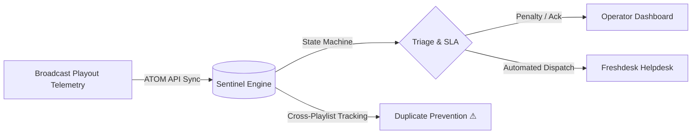

# Sentinel

> **Amagi TOC Alert Monitoring & Ticket Automation Platform**  
> *Real-time broadcast telemetry tracking, playlist version correlation, and automated Freshdesk dispatch.*

---

## Overview

**Sentinel** is an internal operations intelligence dashboard purpose-built for Amagi's **Transmission Operations Center (TOC)** and **Network Operations Center (NOC)** teams. It tracks linear television playout alerts across global broadcast channels, correlates alert occurrences with evolving daily playlist versions, eliminates duplicate tickets when playlists are republished, and automates support ticket creation into Freshdesk with fine-grained contact routing.



---

## Key Features

- **4 Fixed Alert Types (Single Source of Truth)**:
  - 🕳️ `HOLE`: Schedule Gap Detected (unpopulated playout time)
  - 📋 `NO_PLAYLIST`: No Playlist Published for broadcast date
  - ⏱️ `DURATION_MISMATCH`: Asset media duration does not match scheduled duration
  - ☁️ `MISSING_IN_CLOUD`: Media asset missing in cloud storage / production
- **3-State Triaging Lifecycle**: Clear operational accountability (`penalty` ➔ `ack` ➔ `ticketed`).
- **Cross-Playlist Same-Day Ticket Persistence**: Detects if an alert on a revised playlist version was already ticketed earlier in the broadcast day, preventing duplicate customer communications.
- **Granular Freshdesk Contact Routing**:
  - Support for **Customer Tickets** vs. **Internal Tickets** (directed to `amagisupportcontact@amagi.com`).
  - Feed-level general technical contacts.
  - Per-alert-type contact overrides (e.g. directing missing asset alerts to playout ingest teams).
- **OneLogin OIDC Single Sign-On**: Secure enterprise authentication restricted to `@amagi.com` accounts, with seamless automatic dev bypass for local development.
- **Embedded SRE Debug Console**: Built-in hidden diagnostic terminal (hotkey `Ctrl + \`` or keyword `letmein`) for inspecting API traffic, Freshdesk payloads, and system state in real time.

---

## Documentation Hub

Comprehensive architectural, operational, and development documentation is located in [`docs/`](docs/):

| Document | Purpose |
| :--- | :--- |
| 📘 [**docs/ARCHITECTURE.md**](docs/ARCHITECTURE.md) | Deep dive into system design, database schemas, ER diagrams, state machines, and contact resolution logic. |
| 🗺️ [**docs/CODEBASE_MAP.md**](docs/CODEBASE_MAP.md) | File-by-file module guide with exports, dependencies, and component tree mappings. |
| 🛠️ [**docs/OPERATIONS_AND_SECRETS.md**](docs/OPERATIONS_AND_SECRETS.md) | Operational runbooks, environment variable references, triage procedures, and critical security advisories. |
| 🚀 [**docs/UPGRADE_ROADMAP.md**](docs/UPGRADE_ROADMAP.md) | Technical debt audit, security vulnerabilities, and phased modernization plan toward Sentinel v2. |

---

## Quick Start

### Prerequisites
- Node.js 18+ and npm
- (Optional) Docker and Docker Compose

### 1. Local Development (Dev Mode with Bypass Auth)

```bash
# Clone and install dependencies
git clone https://github.com/amagi/sentinel.git
cd sentinel
npm run install:all

# Start backend (Port 3001)
npm run dev:backend

# In a separate terminal, start frontend (Port 3000)
npm run dev:frontend
```
Open **`http://localhost:3000`** in your browser.

### 2. Deterministic Demo Mode
To spin up Sentinel with realistic test data across APAC, US, and EMEA broadcast feeds without requiring live ATOM credentials:

```bash
npm run demo
```

### 3. Docker Deployment

```bash
docker-compose up --build -d
```
Frontend runs on `http://localhost:3000` (Nginx), Backend on `http://localhost:3001`.

---

## SRE Debug Terminal

Sentinel includes an integrated, zero-footprint diagnostic terminal for live triage:

- **Activation**: Type the secret keyword **`letmein`** anywhere on screen, or press **`Ctrl + \``** (Backtick).
- **Dismiss**: Press **`Escape`** or run command `close`.
- **Top Commands**:
  - `status`: High-level summary of regional stats and sync health.
  - `traffic`: Live API latency and HTTP response status codes.
  - `fd payload`: Inspects JSON payloads formatted for Freshdesk.
  - `alerts`: Breaks down all loaded alerts by state.

---

## Technology Stack

- **Backend**: Node.js, Express 4.18, `better-sqlite3` (WAL Mode), Passport.js (`passport-openidconnect`), `connect-sqlite3`, Axios, `node-cron`.
- **Frontend**: React 18, Custom NOC Dark Theme (IBM Plex fonts, electric teal glow tokens), Native Hash Router.
- **Infra**: Docker multi-stage builds, Alpine Linux, Nginx reverse proxy.

---

## License & Operational Notice

*Confidential & Proprietary. Internal tool for Amagi Media Labs Pvt. Ltd. TOC/NOC operations.*
