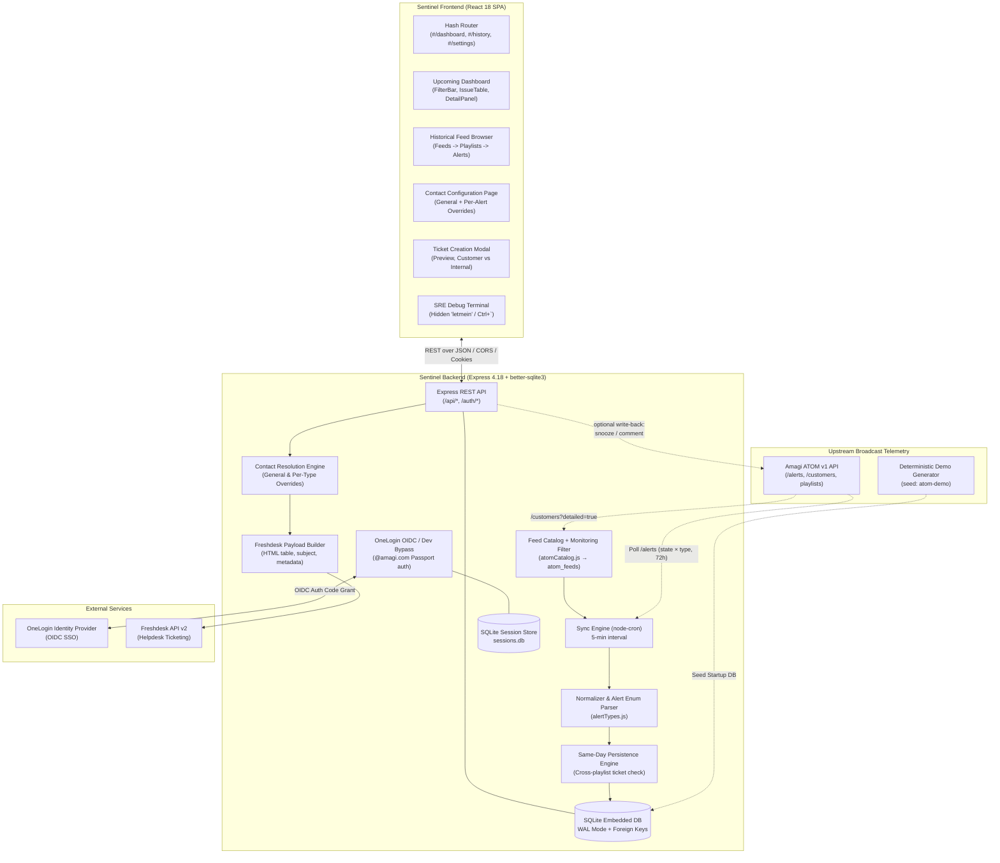
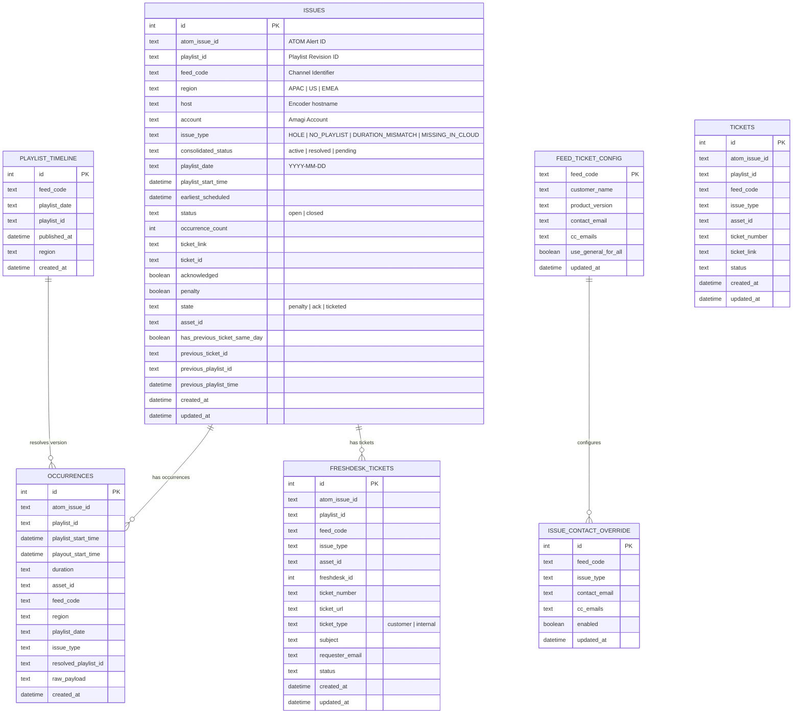
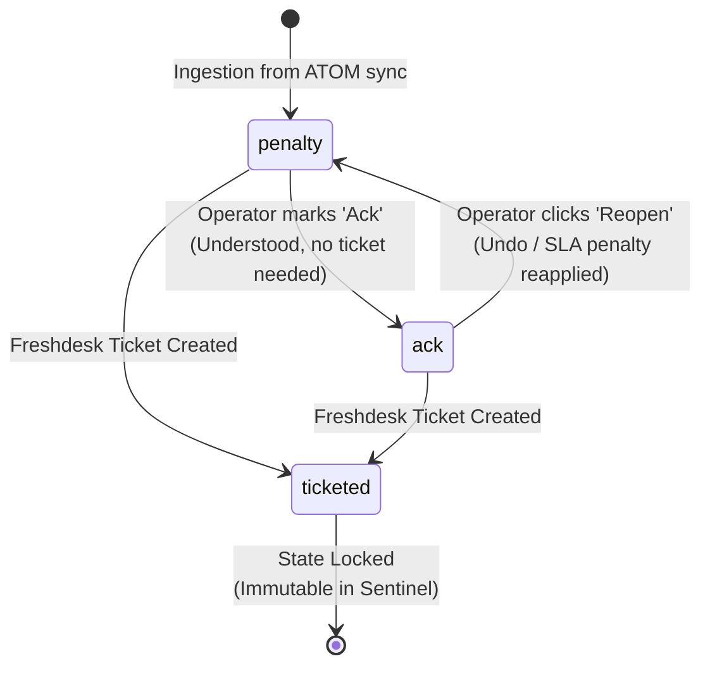

# Sentinel: System Architecture & Design Specification

> **System Designation**: Sentinel (Amagi TOC Alert Monitoring & Ticket Automation)  
> **Target Audience**: SREs, NOC Engineers, Backend/Frontend Developers, Platform Architects  
> **Last Updated**: 2026-11-18  
> **ATOM details**: see [`ATOM_INTEGRATION.md`](ATOM_INTEGRATION.md)  

---

## 1. Executive Summary & Domain Purpose

**Sentinel** is an operations intelligence and automated ticketing platform built for **Amagi Transmission Operations Center (TOC)** and **Network Operations Center (NOC)** teams. It monitors broadcast channel telemetry, identifies broadcast schedule violations across worldwide linear channels, tracks playlist version updates, correlates recurring alerts within 24-hour broadcast days, and automates support ticket creation into Freshdesk with granular contact resolution.

### Primary Operational Problems Solved
1. **Playlist Version Drift & Alert Duplication**: Linear TV schedule automation frequently republishes revised daily playlists (e.g. initial playlist published at 08:00 UTC, revised at 10:15 UTC, re-published at 12:30 UTC). Traditional alert systems file duplicate tickets for the same underlying issue every time a playlist ID changes. Sentinel tracks playlist version timelines and alerts operators if a same-day issue was already ticketed.
2. **Alert Triaging State Machine**: Distinct 3-state workflow (`penalty` -> `ack` -> `ticketed`) ensuring SLA accountability. Penalty-bearing alerts are isolated, acknowledged without noise, or ticketed into customer/internal support workflows.
3. **Multi-Tenant Contact Routing**: Different broadcast feeds require support tickets to be dispatched to specific customer NOC contacts or engineering leads depending on the specific failure type (e.g., missing asset in cloud vs. schedule gaps). Sentinel provides feed-level general contacts and per-alert override routing rules.

---

## 2. High-Level Architecture



---

## 3. Core Domain Entities & Database Schema

Sentinel utilizes **better-sqlite3** with Write-Ahead Logging (`PRAGMA journal_mode = WAL`) and relational foreign key constraints enabled. The database schema consists of seven primary tables:



### Table Definitions & Key Indices

1. **`issues`**: The central record table. Unique composite constraint on `(atom_issue_id, playlist_id)`.
   - Index `idx_issues_composite` on `(atom_issue_id, playlist_id)`
   - Index `idx_issues_feed` on `(feed_code)`
   - Index `idx_issues_region` on `(region)`
   - Index `idx_issues_start` on `(playlist_start_time)`
2. **`occurrences`**: Individual alert timestamps within playout. Insert-only, deduplicated on `(atom_issue_id, playlist_id, playout_start_time, asset_id)`.
   - Index `idx_occ_composite` on `(atom_issue_id, playlist_id)`
   - Index `idx_occ_playout` on `(playout_start_time)`
3. **`playlist_timeline`**: Audit log of playlist publications for a given channel and broadcast date. Chronologically ordered by sequential `playlist_id`.
   - Index `idx_pl_feed_date` on `(feed_code, playlist_date)`
4. **`feed_ticket_config`**: Feed-level customer ticket routing configuration. Primary key `feed_code`.
5. **`issue_contact_override`**: Per-alert-type overrides when `use_general_for_all = 0`. Unique constraint on `(feed_code, issue_type)`.
6. **`freshdesk_tickets`**: Full audit log of tickets created via Freshdesk integration.
7. **`atom_feeds`** (migrations 004, 006): ATOM feed catalog — feed name, customer, AMG ID, timezone, broadcast-day start, headends (with `health.monitoring`), `data_only`, `monitored`. Primary key `feed_code`.

Migrations 004–005 also add the full ATOM alert record to `issues` (`severity`, `alert_name`, `description`, `raw_type`, `consolidated_status` lifecycle, snooze/resolve fields, `duration_ms`, `headend_code`, `automation_url`, `amg_id`, `feed_name`, `source_url`, `dedup_key`, `correlation_id`, `labels`, `custom_details`, `atom_writeback_error`). Column-by-column mapping: [`ATOM_INTEGRATION.md` §4.4](ATOM_INTEGRATION.md#44-field-mapping-normalizealert).

---

## 4. Alert Types: The Four TOC Types + Other ATOM Alerts

The four **TOC types** are defined in `backend/alertTypes.js`. They drive per-type contact overrides and ticket subjects. Every other ATOM type Sentinel ingests, such as rescue played, ingest configuration or asset failed, is kept under its **raw ATOM type**. It appears in the dashboard's **Other ATOM alerts** section, can be acked and ticketed, routes to the feed's general contact, and gets a humanised label (`player_rescue_detected_alert` → "Player Rescue Detected"):

| Canonical Enum Key | UI Display Label | Freshdesk Ticket Subject Template | Description |
| :--- | :--- | :--- | :--- |
| `HOLE` | Hole in Playlist | `TOC Alert [AM3] : Schedule Gap Detected - {FEED} - {DATE}` | Gap in broadcast playlist schedule where no asset is scheduled to air. |
| `NO_PLAYLIST` | No Playlist | `TOC Alert [AM3] : No Playlist Published - {FEED} - {DATE}` | Channel has no playlist published for the specified broadcast day. |
| `DURATION_MISMATCH` | Asset Duration Mismatch | `TOC Alert [AM3] : Asset Duration Mismatch - {FEED} - {DATE}` | Media file physical duration does not match scheduled duration in traffic logs. |
| `MISSING_IN_CLOUD` | Missing in Cloud (Production) | `TOC Alert [AM3] : Asset Missing in Cloud - {FEED} - {DATE}` | Asset scheduled for linear playout has not been ingested or transcoded to cloud storage. |

### Fuzzy Normalization
`toEnumKey(raw)` maps ATOM's type strings onto the four keys: `hole_in_playlist` / `playlist_hole` → `HOLE`, `no_published_playlist` → `NO_PLAYLIST`, `asset_duration_mismatch` → `DURATION_MISMATCH`, `asset_missing_in_cloud` → `MISSING_IN_CLOUD`, plus legacy variants. Anything else returns `null`, and the raw type is kept. The full table is in [`ATOM_INTEGRATION.md` §4.3](ATOM_INTEGRATION.md#43-type-normalisation-alerttypestoenumkey).

---

## 5. State Machine & Triaging Workflow

Sentinel implements an explicit 3-state transition model for upcoming alerts:



1. **`penalty` (Default)**: Alert carries operational/contractual SLA penalties. Displayed prominently with red indicators.
2. **`ack`**: Operator has acknowledged the alert (e.g. deliberate maintenance, known issue). SLA penalty is mitigated. Can be reopened back to `penalty`.
3. **`ticketed`**: Ticket has been created in Freshdesk (or mock). State is permanently locked. Any attempt to modify the state via `PATCH /api/issues/.../state` returns HTTP `409 Conflict`.

### Two independent lifecycles
- **Sentinel triage** (`issues.state`): `penalty` → `ack` → `ticketed`, owned by operators. A sync never overwrites it.
- **ATOM lifecycle** (`issues.consolidated_status`): `active` / `snoozed` / `resolved`, owned by ATOM. Updated on every sync, and by resolution detection for alerts that drop out of ATOM's open list. The dashboard hides `resolved` by default (ATOM state filter "Open").

With `ATOM_WRITEBACK=true`, the two are linked by operator actions only:
- **Ack** with a chosen snooze → ATOM snooze.
- **Reopen** → ATOM de-snooze.
- **Ticket created** → ATOM comment with the ticket link.

Sentinel never resolves an ATOM alert.

---

## 6. Same-Day Cross-Playlist Ticket Persistence

A critical feature of Sentinel is preventing duplicate ticket creation when playout playlists are updated over the course of a day.

### Scenario:
1. At **08:00 UTC**, FailArmy US has Playlist **22262009** for date **2026-04-13**. An alert `MISSING_IN_CLOUD` is detected on asset `FC_FailArmyClip01`.
2. Operator creates Freshdesk ticket **INC-10001**.
3. At **13:30 UTC**, an updated playlist version **22262016** is pushed. The same alert still exists because the asset is still missing.
4. Without persistence tracking, an operator would create a second ticket for the same issue.

### Persistence Engine Implementation (`db.js`):
When a new issue is synced, `checkAndMarkPersistence()` calls `findSameDayPreviousTicket()`:
```sql
SELECT t.*, i.playlist_start_time as prev_playlist_time, i.playlist_id as prev_playlist_id
FROM tickets t
JOIN issues i ON i.atom_issue_id = t.atom_issue_id AND i.playlist_id = t.playlist_id
WHERE t.feed_code  = ?
  AND t.issue_type = ?
  AND (t.asset_id IS NULL OR t.asset_id = ? OR ? IS NULL)
  AND t.playlist_id != ?
  AND DATE(i.playlist_start_time) = DATE(?)
ORDER BY t.created_at DESC
LIMIT 1;
```
If a prior ticket exists on a different playlist version for the same calendar date:
- `has_previous_ticket_same_day` is set to `1`.
- `previous_ticket_id`, `previous_playlist_id`, and `previous_playlist_time` are populated.
- The UI renders an amber warning pill: **"⚠ Ticket already created for a previous playlist version today: {previous_ticket_id}"**, with direct links to view the existing ticket.

---

## 7. Contact Resolution & Ticket Dispatch Hierarchy

When generating a Freshdesk ticket preview or submitting a ticket, Sentinel resolves contacts via `resolveContacts(feed_code, issue_type, ticket_type)`:

```mermaid
flowchart TD
    START([Ticket Dispatch Initiated]) --> TYPE{Is ticket_type == 'internal'?}
    
    TYPE -- YES --> INT[Return Internal Default:<br/>Email: amagisupportcontact@amagi.com<br/>Customer: 'Internal - Amagi'<br/>CCs: []]
    
    TYPE -- NO --> CFG{Does Feed Config exist in feed_ticket_config?}
    
    CFG -- NO --> DEF[Return Empty / Unconfigured:<br/>Customer: null<br/>Email: null]
    
    CFG -- YES --> GEN{Is use_general_for_all == 1?}
    
    GEN -- YES --> RET_GEN[Return General Feed Contacts:<br/>Email: cfg.contact_email<br/>CCs: cfg.cc_emails<br/>Customer: cfg.customer_name]
    
    GEN -- NO --> OVR{Is there an enabled override in<br/>issue_contact_override for (feed_code, issue_type)?}
    
    OVR -- YES --> RET_OVR[Return Overridden Contacts:<br/>Email: override.contact_email || cfg.contact_email<br/>CCs: override.cc_emails || cfg.cc_emails<br/>Customer: cfg.customer_name]
    
    OVR -- NO --> RET_GEN
```

### Ticket Formats:
- **Customer Ticket**: Dispatched to the customer's technical contact. The HTML body has:
    - a formal greeting (`Dear {Customer} Team,`). The customer name falls back to the ATOM catalog when none is configured.
    - a monospace table of whichever fields exist: Feed (+ feed name), AMG ID, Issue Type, Alert name, Severity, Details (ATOM description), Asset ID, Playlist ID / Date, Start Time, Issue Start (UTC + feed local time), Duration, Headend, Automation, Customer, ATOM Alert ID, Link (CloudPort).
    - a TOC sign-off. All values are HTML-escaped.
- **Priority** follows ATOM severity: blocker/critical → 4 (Urgent), major → 3 (High), minor → 2 (Medium), dev → 1 (Low), unknown → 2. It is raised to Urgent when the alert is on-air now or airs within 2 hours.
- **Current wording, coverage of related alerts and follow-ups**: see [`TICKETS_AND_FOLLOWUPS.md`](TICKETS_AND_FOLLOWUPS.md). It supersedes the field list above.
- **Internal Ticket**: Always sent to `amagisupportcontact@amagi.com` (configurable via `INTERNAL_TICKET_EMAIL` env var), regardless of feed settings.

---

## 8. Authentication & Authorization

### Architecture:
- Uses **Passport.js** with `passport-openidconnect` against OneLogin.
- Session persistence uses SQLite via **connect-sqlite3** stored in `sessions.db`.
- **Domain Restriction**: Enforces `ALLOWED_EMAIL_DOMAIN` (defaults to `@amagi.com`). Any login with another email domain triggers an immediate `403 Access Denied`.
- **Dev Bypass Mode**: When `OIDC_ISSUER` or `OIDC_CLIENT_ID` are left blank in `.env`, the system enters Dev Bypass mode. All requests are authenticated automatically as `dev@amagi.com` with `_bypass: true`.

---

## 9. SRE Debug Terminal (`SRETerminal.js`)

Sentinel includes a hidden, zero-footprint engineering console designed for NOC/SRE triage during live operational incidents.

### Activation Triggers:
1. Type the secret keyword **`letmein`** anywhere on the keyboard.
2. Press **`Ctrl + \``** (Control + Backtick).
3. Press **`Escape`** or run command `close` to dismiss.

### Architecture:
The terminal intercepts real-time application events via an in-memory event bus (`SREBus`):
- `logTraffic()`: Tracks HTTP method, endpoint, status code, and latency in milliseconds.
- `logFD()`: Tracks Freshdesk preview requests, payloads, API responses, and errors.
- `logState()`: Captures state machine transitions (`penalty` -> `ack`).
- `logError()`: API and client exceptions.

### Command Reference:
| Command | Action |
| :--- | :--- |
| `status` | Summarizes regional counts, state totals, and sync status |
| `selected` | Displays all metadata and occurrences for the currently selected alert |
| `alert <feed>` | Searches alerts matching a specific channel code |
| `traffic` | Displays the last 20 API calls with millisecond timing |
| `fd [payload\|response\|errors]` | Inspects Freshdesk API interactions and payloads |
| `states` | Groups all loaded issues by state |
| `poll` | Displays polling timers and intervals |
| `clear` | Clears terminal screen |
