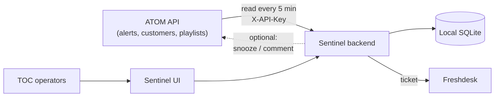

# Sentinel → ATOM: API Access Request

> **Requested by**: TOC — Sentinel maintainers (contact: _<name / Slack channel>_)
> **For**: ATOM platform team
> **Date**: 2026-11-18
> **Environment**: Production `https://am.amagi.tv/v1/api` (and staging `https://am-staging.amagi.tv/v1/api` for testing)

---

## 1. The ask

Please provision a **service API key (`X-API-Key`)** for Sentinel, the TOC alert-triage and ticketing tool, with:

| # | Scope | Endpoints | Why | Today |
|---|---|---|---|---|
| 1 | **Read alerts** (all CP feeds, all orgs TOC covers) | `GET /alerts`, `GET /alerts/{alert_id}` (incl. `history=true`) | Core ingestion + resolution tracking | Works with a personal SSO token |
| 2 | **Read customer / feed catalog** | `GET /customers/{automation_url}?detailed=true` | Feed names, timezones, broadcast-day start, headends and the **monitoring switch** | Works with a personal SSO token |
| 3 | **Read playlists** | `GET /cache/published_playlist`, `GET /customers/{automation_url}/feeds/{feed_code}/playlist` | Playlist-version tracking and "what was playing when the alert fired" | **403 Forbidden** for the `atom-prod_atom_operator` role |
| 4 | **Update alerts — snooze / de-snooze / comment only** _(optional, can come later)_ | `PATCH /alerts` with `action: snooze \| desnooze` or `comment` | Mirror TOC acknowledgements into ATOM and link Freshdesk tickets on the alert | Not used yet |

Sentinel **never resolves** alerts and **never patches `labels` or `custom_details`**. This is enforced in code and covered by tests. If scope 4 needs separate approval, a **read-only key (1–3) unblocks us today**.

---

## 2. What Sentinel is

Sentinel is the TOC/NOC dashboard for **playlist and media alerts that need human action before air**:

- It pulls open alerts from ATOM every 5 minutes and shows them grouped as **TOC alerts** and **Other ATOM alerts**:
  - TOC alerts: hole in playlist, no published playlist, asset duration mismatch, asset missing in cloud.
  - Other ATOM alerts: real faults such as rescue played, ingest configuration, asset failed or QC failed.
- Operators triage each alert: Penalty → Ack → Ticketed.
- Operators raise customer or internal **Freshdesk tickets** with the alert details filled in. Contacts are routed per feed.
- It stops duplicate tickets when a playlist is republished on the same broadcast day.

---

## 3. Every ATOM call Sentinel makes

| Method | Path | Parameters Sentinel sends | Purpose | When |
|---|---|---|---|---|
| GET | `/alerts` | `state` (one of `active`, `snoozed`), `type` (one per call), `entity[product]=CP`, `issue_start_time` (now − 72h), `limit=500`, `offset`, `sort_by=issue_start_time` | Ingest open alerts | Every sync |
| GET | `/alerts/{alert_id}` | — | Confirm an alert that dropped out of the list was resolved | Every sync, ≤ 200 alerts |
| GET | `/alerts/{alert_id}` | `history=true` | Lifecycle/transition history in the detail panel | On demand (operator opens an alert) |
| GET | `/customers/{automation_url}` | `detailed=true` | Feed catalog: names, `time_zone`, `broadcast_start_time`, headends, `health.monitoring`, `data_only` | Each automation at most every 6h |
| GET | `/cache/published_playlist` | `automation_url`, `feed_code`, `playlist_date` | Track published playlist versions per broadcast day | Each feed/date at most every 30 min, ≤ 150 per sync |
| GET | `/customers/{automation_url}/feeds/{feed_code}/playlist` | `playlist_date`, `format=common` | Items around the alert time (title, asset, start, duration, status) | On demand, cached 5 min |
| PATCH | `/alerts` | `[{alert_id, action:"snooze", snooze_until}]`, `[{alert_id, action:"desnooze"}]`, `[{alert_id, comment}]` | Optional write-back | Only on operator action, only when enabled |

**Why one `state` and one `type` per call:** production `/alerts` accepts only the singular `state` and `type` filters. Staging also has the plural `states` and `types`.

---

## 4. Alert types Sentinel ingests

These were chosen from a production census on 2026-11-18. That day there were **21,379 open CP alerts**.

| Group | ATOM `type` | Open on prod |
|---|---|---|
| TOC | `asset_missing_in_cloud` | 2,898 |
| TOC | `hole_in_playlist` | 1,372 |
| TOC | `no_published_playlist` | 863 |
| TOC | `asset_duration_mismatch` | 246 |
| Fault | `ingest_configuration_issue_alert` | 1,148 |
| Fault | `player_rescue_detected_alert` | 792 |
| Fault | `asset_failed` | 344 |
| Fault | `player_no_playlist_scheduled_status_alert`, `asset_qc_failed`, `ingest_health_error_black_frame`, `incorrect_som`, `ingest_health_error_freeze_frame`, `sidekiq_high_crash_status_alert`, `subtitle_tcin_not_present_status_alert`, `player_websocket_handshake_bad_gateway_status_alert`, `tardis_livein_app_incorrect_config_status_alert`, `avs_av_sync_failure_alert`, `avs_subtitle_sync_failure_alert`, `playlist_publish_blocked_status_alert`, `player_no_input_stream_alert`, `plsh_pubnub_connection_failure_status_alert`, `playlist_missing_in_player_status_alert`, `tarang_media_seq_stall_alert` | 136 combined |
| **Not ingested** | `asset_download_waiting`, `asset_submitted`, `asset_queued` (pipeline progress, not faults) | 13,580 |

On top of the type filter, Sentinel keeps only alerts that:
- **started within the last 72 hours, or haven't started yet** (`issue_start_time ≥ now − 72h`), and
- are on a **monitored feed**: the customer is not `data_only`, and the alert's headend (or, without one, any headend of the feed) has `health.monitoring = true`.

In the first production sync, the monitoring filter removed about 15% of alerts on catalogued feeds.

---

## 5. Expected load

Sentinel pulls the alerts in TOC's **saved ATOM views** (`GET /alerts?view_id=…&state=…`): the region/customer Schedule, Asset and Live views plus Playout Rescue, 26 views in all. Load is capped on Sentinel's side:

| Guardrail | Value |
|---|---|
| Max requests per rolling minute (all endpoints, incl. token refresh) | **20** |
| Requests in flight at once | **1** |
| Sync interval | every **10 min**; a server restart doesn't trigger an extra sync |
| Circuit breaker | after 3 timeouts/5xx in a row, or any 429, Sentinel **stops calling ATOM** for 2 → 4 → … → 30 min and honours `Retry-After` |

| Call | Per sync | Per day (typical) |
|---|---|---|
| `GET /me/views` | 1 | 144 |
| `GET /alerts?view_id=…` (26 views × active/snoozed, stops at the 72h window) | ~55–60 | ~8,000 |
| `GET /alerts/{id}` (alerts that left the views but were triaged) | ≤ 25 | usually far fewer |
| `GET /customers/{url}?detailed=true` | only when a catalog is > 24h old, ≤ 50 | ~170 |
| Playlist endpoints | ≤ 20 (1 while forbidden) | small |
| `PATCH /alerts` (if write-back is enabled) | operator actions only | tens |

**About 6–9k requests a day, never more than 20 in any minute.** If ATOM has a preferred rate or interval, tell us and we'll set it. All of the above are settings.

An earlier version without these limits sent about 4,000 requests in 2 hours, with parallel bursts, during the 2026-11-18 incident. That's why the caps and the breaker exist.

**Alternative to polling:** ATOM's notification policies (Reactor) could push alert events to a Sentinel webhook instead. We'd be glad to discuss that as a later step.

---

## 6. Security and data handling

- **Key storage.** The key lives only in the backend's runtime environment: `backend/.env`, which is git-ignored and readable only by its owner, or a secret manager in deployment. It is **never** committed to git and **never** baked into Docker images; `.dockerignore` excludes `.env`.
- **What Sentinel stores.** Alert fields, the feed catalog (names, timezones, headends) and operator triage state, all in a local SQLite database on the Sentinel host. It does not store tokens in that database.
- **Who can use it.** Internal TOC/NOC staff sign in through company SSO (OneLogin, restricted to `@amagi.com`).
- **Write-back safeguards:**
  - Off unless `ATOM_WRITEBACK=true` is set.
  - The client refuses `action: resolve` and any `labels` or `custom_details` patch before sending.
  - Every write comes from an explicit operator action (Ack with a chosen snooze time, or ticket creation). Nothing is written automatically.
  - Failures are shown to the operator and logged. They never block the local action.
- **Identity.** With a service key, ATOM's `snoozed_by` and comment authorship would show the Sentinel service rather than an individual. Ticket comments include the operator's email, e.g. `Sentinel: Freshdesk #INC-1234 (customer) created by user@amagi.com — <link>`.

---

## 7. Why the current setup isn't sustainable

Today Sentinel runs on **one engineer's personal SSO session**:

| Problem | Impact |
|---|---|
| The access token expires after about **24 hours** | Ingestion stops until someone pastes a new token |
| SSO refresh tokens **rotate on every use** | Sentinel and that person's browser invalidate each other's session |
| The personal role (`atom-prod_atom_operator`) gets **403 on playlist endpoints** | No playlist-version tracking and no playlist context for operators |
| All calls and any write-back appear as **that individual** | Hard to audit, and access ends if that person leaves |
| Email/password login (`/auth/user/login`) returns *user not found* | Amagi users are SSO-only, so there's no non-interactive fallback |

---

## 8. Questions for the ATOM team

1. Can the key cover **all CP feeds** that TOC monitors (all orgs), not just one organization's ACL?
2. Does ATOM grant permissions **per scope**, for example a read-only key now and snooze/comment write later? If so, which scope names should we request?
3. Are there **rate limits** or preferred polling intervals for `/alerts` and `/customers`?
4. Is **`health.monitoring` on headends** (plus customer `data_only`) the authoritative "monitored feed" switch? Or should we use the `monitored_feeds` list instead?
5. Is `asset_download_waiting` ever a fault TOC should act on, or always transient?
6. What are the expected **key rotation** policy and process?
7. Would you rather **push** alerts to Sentinel via notification policies or a webhook than have it poll?

**Next step:** once a key is issued, we set `ATOM_API_KEY` on the Sentinel host, confirm a full sync on staging and then production, and share the measured request volume with you.
