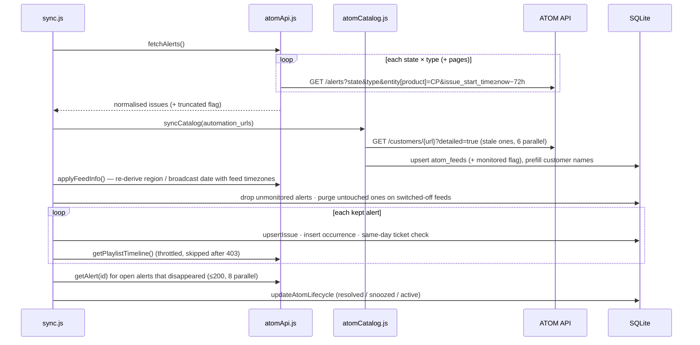

# Sentinel ↔ ATOM Integration Reference

> **Scope**: How Sentinel reads from, and optionally writes to, the ATOM v1 API: auth, ingestion, field mapping, feed catalog, monitoring filter, resolution tracking, playlists, write-back, endpoints, schema, tests and troubleshooting.
> **Code**: `backend/atomApi.js` (client), `backend/sync.js` (scheduler), `backend/atomCatalog.js` (feed catalog), `backend/atomTime.js` (timezones), `backend/db.js` (storage), `backend/server.js` (routes)
> **ATOM API docs**: prod `https://am.amagi.tv/v1/api/docs` · staging `https://am-staging.amagi.tv/v1/api/docs` (machine-readable spec at `…/docs.yaml`)
> **Last updated**: 2026-11-18

---

## 1. Overview

Every 5 minutes (`node-cron`, plus once at startup and on `POST /api/sync`), Sentinel runs one sync:



Modes (`atomApi.js`):

| Mode | When | Behaviour |
|---|---|---|
| Live | `ATOM_BASE_URL` set, `DEMO_MODE` not `true` | Real ATOM calls |
| Demo | `DEMO_MODE=true` | No ATOM calls; deterministic seed (`demoData.js`) incl. feed catalog, severities and 3 non-TOC alerts; playlist context is synthetic |
| Mock | Neither set | **Realistic offline ATOM** (`atomMock.js`): prod-shaped alerts in the same saved views (EMEA / APAC / America / Enterprise Customer / Bein EMEA, Schedule / Asset / Live, Service Alerts), a feed catalog with timezones and headends, deterministic per day, resolving over time. Goes through the real view → normalise → catalog path; makes **no network calls** |

---

## 2. Configuration

All variables live in `backend/.env`, loaded at startup by the small loader at the top of `server.js`. Real environment variables win over the file, and the loader is skipped under `NODE_ENV=test`. Docker reads the same file through `env_file`.

| Variable | Default | Meaning |
|---|---|---|
| `ATOM_BASE_URL` | empty (= mock) | API base **including** `/v1/api`. Prod `https://am.amagi.tv/v1/api` |
| `ATOM_API_KEY` | — | Service key → `X-API-Key` header. Highest priority |
| `ATOM_ALLOW_TOKEN_RENEWAL` | `false` | Allow automatic token renewal (refresh token / login). Off: only API key or a pasted access token |
| `ATOM_REFRESH_TOKEN` | — | SSO **refresh** token; used only when renewal is allowed (§3) |
| `ATOM_BEARER_TOKEN` | — | SSO **access** token (`eyJ…` JWT, ~24h). Also used as the first access token in refresh mode |
| `ATOM_EMAIL` / `ATOM_PASSWORD` | — | Credentials login (`/auth/user/login`). Not available for Amagi SSO users |
| `ATOM_SESSION_FILE` | `backend/.atom_session.json` | Where rotated refresh tokens are saved (Docker: `/app/data/.atom_session.json`) |
| `ATOM_MAX_REQUESTS_PER_MIN` | `20` | **Hard cap** on ATOM requests started in any rolling minute, including token refresh |
| `ATOM_MAX_CONCURRENCY` | `1` | ATOM requests in flight at once |
| `ATOM_SYNC_ASSET_MIN` | `15` | Minutes between syncs of the `<Group> Asset` views (5–120) |
| `ATOM_SYNC_SCHEDULE_MIN` | `30` | Minutes between syncs of the `<Group> Schedule` views (5–120) |
| `ATOM_SYNC_OTHER_MIN` | `15` | Minutes between syncs of every other selected view: Live views, Service Alerts (5–120) |
| `ATOM_VIEWS` | `auto` | **Ingest by ATOM saved views** (§4.0). `auto` = Schedule/Asset/Live views of the `ATOM_VIEW_GROUPS` groups + Service Alerts; `16,19,31` = these view ids; `off` = legacy type-based ingestion |
| `ATOM_VIEW_TIMEOUT_MS` | `120000` | Per-request timeout for view queries (some views take ATOM > 60 s) |
| `ATOM_ALERT_TYPES` | empty = built-in list (§4.2) | Type mode only. Comma-separated override; `*` or `all` = every type |
| `ATOM_ALERT_STATES` | `active,snoozed` | States to pull (one request per state) |
| `ATOM_PRODUCT` | `CP` | `entity[product]` filter; empty = all products |
| `ATOM_LOOKBACK_HOURS` | `72` | Only `issue_start_time ≥ now − N h` (upcoming always included); `0` = no window |
| `ATOM_PAGE_SIZE` | `500` | `limit` per `/alerts` page (ATOM max 1000) |
| `ATOM_MAX_PAGES` | `20` | Pages per state×type query; hitting it marks the sync **truncated** |
| `ATOM_CATALOG_REFRESH_HOURS` | `24` | Re-fetch a customer's feed catalog after this long |
| `ATOM_CATALOG_MAX_PER_SYNC` | `50` | Automations fetched per sync |
| `ATOM_RESOLVE_CHECKS_PER_SYNC` | `25` | `GET /alerts/{id}` resolution checks per sync |
| `ATOM_PLAYLIST_LOOKUPS_PER_SYNC` | `20` | Published-playlist lookups per sync (each feed+date ≤ every 30 min) |
| `ATOM_WRITEBACK` | `false` | `true` = Ack→snooze, Reopen→de-snooze, ticket→comment (§10) |

---

## 2a. Protecting ATOM (rate limit + circuit breaker)

On 2026-11-18 ATOM prod went down while Sentinel was sending about 4,000 requests in 2 hours, with bursts of many parallel requests. Every ATOM call now goes through `backend/atomGuard.js`:
- **Rate cap.** At most `ATOM_MAX_REQUESTS_PER_MIN` (20) requests start in any rolling minute, with at most `ATOM_MAX_CONCURRENCY` (1) in flight. Token refresh and login count too.
- **Circuit breaker.** After 3 consecutive timeouts, network errors or 5xx responses, or immediately on a 429 (honouring `Retry-After`), **all** ATOM calls stop for 2 min. The pause doubles on each repeat (4, 8, … up to 30 min). Syncs are skipped while paused. 4xx such as 401/403/404 don't count.
- **No restart storms.** The last successful sync time is stored (`app_meta`). A restart only syncs the lanes whose last success is older than their interval. The scheduler ticks every 5 min and fetches only the due lanes (Asset + Schedule + other share one run when due together). A lane-only run never purges or resolution-checks alerts that sit in views of other lanes, and keeps their membership of those views.
- **Visible.** `/api/sync/status → atom_rate` reports `limit_per_min`, `used_last_min`, `in_flight`, `total_requests`, `paused_until` and `pause_reason`. The sidebar shows "ATOM calls paused until …".

Expected load in view mode with defaults: about 55–60 view pages, up to 25 resolution checks and up to 20 playlist lookups per sync (just 1 when playlists are 403'd), plus catalog lookups only when a catalog is over 24h old. With per-lane intervals (Asset and other views every 15 min, Schedule views every 30 min) that is roughly **3–5k requests/day, never more than 20 in a minute** (hard ceiling 28,800/day).

## 3. Authentication

### 3.1 Priority
**Automatic token acquisition is OFF by default** (`ATOM_ALLOW_TOKEN_RENEWAL=false`). Sentinel only uses `ATOM_API_KEY` or a manually pasted `ATOM_BEARER_TOKEN`, which is never renewed. It never calls `/auth/sso/refresh` or `/auth/user/login` by itself. If only a refresh token or login is configured, every sync fails with a clear message and **no request is sent**.

With `ATOM_ALLOW_TOKEN_RENEWAL=true` the priority is `ATOM_API_KEY` → `ATOM_REFRESH_TOKEN` → `ATOM_BEARER_TOKEN` → `ATOM_EMAIL`+`ATOM_PASSWORD`. If none is set while live, every sync fails with *"ATOM_BASE_URL is set but no credentials…"*.

| Mode | Header | Renewal | Notes |
|---|---|---|---|
| `api_key` | `X-API-Key: <key>` | none needed | Requested from the ATOM team (`docs/ATOM_API_ACCESS_REQUEST.md`) |
| `refresh` | `Authorization: Bearer <access>` | `POST /auth/sso/refresh {refresh_token}` 2 min before expiry and after any 401 | Rotation persisted (§3.2) |
| `bearer` | `Authorization: Bearer <access>` | none — paste a new one when it expires | Expiry read from the JWT `exp` claim |
| `login` | `Authorization: Bearer <token>` | re-login 60 s before expiry and after a 401 | Amagi SSO users get *"user not found"* |

### 3.2 Refresh-token rotation
- Every refresh returns a **new** refresh token and invalidates the old one.
- Sentinel writes the newest pair to `ATOM_SESSION_FILE` (mode `0600`). The file records a fingerprint of the `ATOM_REFRESH_TOKEN` it grew from. A restart continues from the file; pasting a **new** `ATOM_REFRESH_TOKEN` takes precedence over it.
- Refreshes are single-flight: many requests needing a new token share one refresh call.
- On failure, the message shown in the sidebar and in `/api/sync/status → atom_auth.error` is *"Token refresh failed (401)… Copy a fresh refresh token from the ATOM web app into ATOM_REFRESH_TOKEN."*

### 3.3 Getting a token by hand (until the API key exists)
ATOM prod is SSO-only (org `amagi`). Email/password login does not work for Amagi accounts.

- **Access token (24h):** sign in at `https://am.amagi.tv` → DevTools → Network → request `me` → Request Headers → copy the value after `Bearer `. Put it in **`ATOM_BEARER_TOKEN`**. It starts with `eyJ`.
- **Refresh token (auto-renew):** in an **incognito** window, sign in → DevTools → Application → Local Storage (or Network → the `token` request's Response). Copy `refresh_token`; it does **not** start with `eyJ`. Close the window **without logging out**, then put the value in **`ATOM_REFRESH_TOKEN`**. A separate session is needed because rotation would otherwise log your normal browser out.
- Check a token: `curl -s -H "Authorization: Bearer $TOKEN" https://am.amagi.tv/v1/api/me`.
- `/me` for the current personal account shows role `operator` (`atom-prod_atom_operator`). That role gets **403 on playlist endpoints** (§9).

---

## 4. Ingestion

### 4.0 By ATOM saved views (default)
ATOM views (`GET /me/views`) carry each team's scope **and its ignore rules**, e.g. "ignore schedule alerts for feeds X", "playout after 12h", "hole under 2000 ms". Sentinel therefore pulls **the alerts present in the selected views**, so TOC sees what the views show.

- **Selection (`ATOM_VIEWS=auto`):**
    - Included: `<Group> Schedule|Asset|Live [Alerts]` views of the monitored groups — `ATOM_VIEW_GROUPS`, default **AN1, AN2, AN3, Cloudport Now, America, Enterprise Customer, EMEA, APAC** — plus `Service Alerts`. Other groups (Bein EMEA, Hearst Network, NBCU UK, WBD, …) and `Playout Rescue` are not ingested.
    - TOC section: the 4 TOC types plus every alert in an `<Group> Asset` view (e.g. Asset Download Waiting, Asset QC Failed); everything else is "Other ATOM alerts".
    - Excluded: catch-alls (`All CP …`, `All AN3 Alerts`) and everything else (Playout Rescue, TS, AdOps, Player Crash, MCR Supervisors, PBSD, `Live alerts`).
    - Explicit ids override this.
- **Query:** `GET /alerts?view_id=<id>&state=<active|snoozed>&sort_by=issue_start_time&sort_order=desc&limit&offset`.
    - ATOM rejects every other filter with `view_id` (only state, sort, group_by, issue_start_time, end_time, limit and offset are allowed). It accepts `issue_start_time` but **ignores** it.
    - So the 72h window is applied by Sentinel, which stops paging at the first alert older than the cutoff.
    - Views are fetched 4 at a time with a 120 s timeout. `view_ids` (multi-view) is not used: it has no pagination and stops at 1,000.
- **Tagging:** each alert stores the views it appears in (`atom_view_ids` like `,16,19,`, plus `atom_view_names`). The first view's **group** becomes `view_group` **and the region**; its family (Schedule/Asset/Live) becomes `view_family`.
- **Scope changes:**
    - After a complete fetch, untouched alerts (Penalty, no ticket) that are in no selected view any more are purged. That covers resolved alerts and alerts a view's ignore rule now hides.
    - Acked or ticketed alerts stay, and resolution detection keeps them current.
    - **If any view fails or times out, the sync counts as incomplete and nothing is purged.**
- **In view mode, the type list (§4.2) and the headend-monitoring filter (§5.2) are not used.** The views decide.
- **UI:**
    - The sidebar lists **ATOM views** by group with "needs action" counts; expand a group for Schedule / Asset / Live. Routes look like `#/dashboard/emea/schedule`.
    - The drawer's Overview shows the alert's ATOM views.
    - API: `GET /api/views`; filters `region` (group, case-insensitive), `view_family`, `view_id`.
- **Prod snapshot (2026-11-18, open, last 72h):** EMEA Schedule 4, APAC Schedule 10, Enterprise Customer Schedule 5, America Schedule 113, America Asset 47, Bein EMEA Asset 103, Playout Rescue 1000+. AN2 and AN3 Asset views timed out at 150 s.

### 4.1 Type mode: query plan (`ATOM_VIEWS=off`, or when `/me/views` is unavailable)
Production `/alerts` supports only the singular `state` and `type` filters, so Sentinel sends one query per **state × type**:

```
GET /alerts?state=<state>&type=<type>&entity[product]=CP&issue_start_time=<now−72h ISO>
           &limit=500&offset=<n>&sort_by=issue_start_time&sort_order=desc
```
- Pages are followed until `has_next` is false. Results are de-duplicated by `alert_id` across queries.
- If a query reaches `ATOM_MAX_PAGES`, the sync is marked `truncated`. Resolution detection is then skipped, so a partial list never marks alerts resolved.

### 4.2 Alert types pulled (built-in default)

| Group | Types |
|---|---|
| TOC (mapped to Sentinel's 4 types) | `asset_missing_in_cloud`, `hole_in_playlist`, `no_published_playlist`, `asset_duration_mismatch` |
| Other faults (kept with their raw type) | `ingest_configuration_issue_alert`, `player_rescue_detected_alert`, `asset_failed`, `asset_qc_failed`, `player_no_playlist_scheduled_status_alert`, `ingest_health_error_black_frame`, `ingest_health_error_freeze_frame`, `incorrect_som`, `sidekiq_high_crash_status_alert`, `subtitle_tcin_not_present_status_alert`, `player_websocket_handshake_bad_gateway_status_alert`, `tardis_livein_app_incorrect_config_status_alert`, `avs_av_sync_failure_alert`, `avs_subtitle_sync_failure_alert`, `playlist_publish_blocked_status_alert`, `player_no_input_stream_alert`, `plsh_pubnub_connection_failure_status_alert`, `playlist_missing_in_player_status_alert`, `tarang_media_seq_stall_alert` |
| Deliberately excluded | `asset_download_waiting`, `asset_submitted`, `asset_queued` (pipeline progress; 13,580 open on prod 2026-11-18) |

New ATOM types do **not** appear automatically. Add them to `ATOM_ALERT_TYPES`, or to `DEFAULT_ALERT_TYPES` in `atomApi.js`.

### 4.3 Type normalisation (`alertTypes.toEnumKey`)

| ATOM type (any case/spacing) | Sentinel `issue_type` |
|---|---|
| `hole_in_playlist`, `hole_in_the_playlist`, `playlist_hole`, `schedule_gap`, `hole` | `HOLE` |
| `no_published_playlist`, `no_playlist_published`, `missing_playlist`, `no_playlist` | `NO_PLAYLIST` |
| `asset_duration_mismatch`, `duration_mismatch` | `DURATION_MISMATCH` |
| `asset_missing_in_cloud`, `missing_in_cloud`, `asset_missing`, `missing_in_cloud_(production)` | `MISSING_IN_CLOUD` |
| anything else | the raw type, e.g. `player_rescue_detected_alert` (label: *Player Rescue Detected*) |

`raw_type` always keeps ATOM's original string.

### 4.4 Field mapping (`normalizeAlert`)
`custom` = `entity.custom`, `details` = `custom_details`; a value is taken from `custom` first, then `details`.

| ATOM field | Sentinel column | Notes |
|---|---|---|
| `alert_id` | `atom_issue_id` | Primary identity (with `playlist_id`) |
| `type` | `issue_type`, `raw_type` | §4.3 |
| `state` | `consolidated_status` | `active` / `snoozed` / `resolved` (ATOM lifecycle; separate from triage `state`) |
| `severity` | `severity` | `blocker`, `critical`, `major`, `minor`, `dev` |
| `name` / `description` | `alert_name` / `description` | |
| `issue_start_time` (else `created_at`) | `earliest_scheduled`; occurrence `playout_start_time` | |
| `duration` (ms, `-1` = ongoing) | `duration_ms`; occurrence `duration` (`"300s"` / `"ongoing"`) | |
| `custom.feed_code` | `feed_code` | |
| `labels.feed_name` → catalog `feed_name` → `entity.name` | `feed_name` | `entity.name` is the feed's display name, not a host |
| `entity.amgID` | `amg_id` | e.g. `AMG01079` |
| `custom.automation_url` | `automation_url` | Needed for catalog/playlist calls |
| `custom.account_domain` → `entity.amgID` | `account` | |
| `custom.headend_code` | `headend_code`, `host` | |
| `custom.playlist_id` | `playlist_id` | Often absent → `''` |
| `custom.playlist_date` → derived (§6) | `playlist_date` | Broadcast date |
| `custom.asset_id` | `asset_id` | |
| `details.playlist_url` / `asset_url` / `url` | `source_url` | "Open in CloudPort ↗" link |
| `entity.product` / `entity.service` | `product` / `entity_service` | |
| `dedup_key`, `correlation_id` | same names | |
| `snoozed_until`, `snoozed_by` | same | Only while `state = snoozed` |
| `resolved_at`, `resolved_by` | same | Only while `state = resolved` |
| `updated_at` (else `timestamp`) | `atom_updated_at` | |
| `labels`, `custom_details` | `labels`, `custom_details` (JSON) | |
| whole alert | `occurrences.raw_payload` | Each alert = one occurrence |

On updates, ATOM columns are overwritten only by ATOM syncs (`atom_sync` flag). Sentinel's triage `state` is never overwritten by a sync.

---

## 5. Feed catalog and the monitoring switch

### 5.1 Catalog (`atomCatalog.js` → `atom_feeds`)
For each `automation_url` seen on alerts whose catalog is missing or older than 6h, Sentinel calls `GET /customers/{url}?detailed=true` and stores one row per feed:
- `feed_name`, `customer_name`, `amg_id`, `account_domain`, `time_zone`, `broadcast_start_time`, `days_to_monitor`, `headends_json` (code, name, active, `health`), `data_only`, `monitored`.
- If `feed_ticket_config.customer_name` is **empty**, it is pre-filled from ATOM. A manually entered name is never overwritten.
- First prod sync: 620 feeds across 49 automations (before the per-sync limit was raised to 300).

### 5.2 Monitored feeds (`db.isAlertMonitored`)
An alert is **kept** unless one of these applies:

| Rule | Result |
|---|---|
| Feed not in the catalog | **kept** (fail open) |
| Customer `data_only = true` ("monitoring is off") | dropped |
| Alert names a headend whose `health.monitoring = false` | dropped |
| No headend of the feed has `health.monitoring = true` | dropped |
| Feed has no headend data at all | kept |

- When a feed is switched off, `purgeUnmonitoredAlerts()` deletes its alerts that are still **Penalty and never ticketed**. Acked or ticketed rows stay for the record.
- Dropped alerts are not resolution-checked.
- Production on 2026-11-18: 948 headends (654 monitoring on, 294 off); 132 of 620 feeds had no monitored headend.

---

## 6. Region and broadcast date

**Region** (first that resolves):
1. Feed timezone from the catalog: `America/*` → US · `Europe/*`, `Africa/*` → EMEA · `Asia/*`, `Australia/*`, `Pacific/*` → APAC.
2. Feed-code prefix (`inferRegion`, a short legacy list).
3. Cloud region `infra.region` (`us-*` / `eu-*` / `ap-*`).

**Broadcast date** (`playlist_date`):
1. `custom.playlist_date`, if ATOM sends it (playlist/asset alerts do).
2. Otherwise `issue_start_time` in the feed's `time_zone`, minus the feed's `broadcast_start_time`. For example, 05:40 IST with a 06:00 start belongs to the **previous** broadcast day.
3. Otherwise the UTC date.

---

## 7. Resolution detection

ATOM drops resolved alerts from the `active`/`snoozed` lists. After each **complete** (not truncated) fetch, Sentinel:
1. Takes open ATOM rows in the DB that didn't come back, oldest first, up to 200.
2. Calls `GET /alerts/{id}` for each, 8 in parallel.
3. Records the result: `resolved` (with `resolved_at` and `resolved_by`, and `status='resolved'`), `snoozed`, or `active`. A 404 leaves the row untouched.

ATOM itself auto-resolves alerts after their duration expires. Ongoing alerts (duration `-1`) are auto-resolved after 72h, which matches the default lookback.

---

## 8. Occurrences, playlist versions and same-day tickets

- **Occurrences**: each ATOM alert becomes exactly one occurrence, built from its start time and duration, with the full alert as `raw_payload`. No extra API call is made.
- **Playlist versions**: `GET /cache/published_playlist` returns only the **current** published playlist. Sentinel builds the version timeline (`playlist_timeline`) across syncs.
- **Same-day ticket warning**: unchanged. If a different playlist version of the same feed, type and asset was ticketed that day, the issue is flagged "Ticketed earlier today".

---

## 9. Playlist context (detail drawer → Playlist tab)

`GET /api/issues/:atomIssueId/playlist/:playlistId/context`:
- Calls `GET /customers/{automation_url}/feeds/{feed_code}/playlist?playlist_date=…&format=common`. Results are cached per feed/date for 5 minutes, up to 200 entries.
- Returns the item playing at the alert time, ±2 items around it, and any item with the alert's `asset_id`. Each item has title, asset, type, start, duration and status.
- `{available:false}` when no playlist is published.

**403 handling**: the `operator` role is forbidden on both playlist endpoints. After the first 403, Sentinel stops calling that endpoint for **6 hours** and logs *"…403 Forbidden for this ATOM role — skipping it for 6h"*. The context route returns 403 with a clear message.

---

## 10. Write-back (`ATOM_WRITEBACK=true` only)

| Sentinel action | ATOM call | Notes |
|---|---|---|
| **Ack** with a snooze choice | `PATCH /alerts [{alert_id, action:"snooze", snooze_until}]` | The picker offers 1 hour, 4 hours, end of broadcast day (feed timezone), or **Ack only** (no ATOM call) |
| **Reopen** (ack → penalty) on a snoozed alert | `PATCH /alerts [{alert_id, action:"desnooze"}]` | |
| **Freshdesk ticket created** | `PATCH /alerts [{alert_id, comment}]` | `Sentinel: Freshdesk #<n> (<customer\|internal>) created by <email> — <url>`, truncated to 512 characters |

Safeguards:
- **Never** resolves. **Never** patches `labels` or `custom_details`, which ATOM replaces wholesale. The client refuses both before sending.
- `snooze_until` must be a future time within 7 days, and only with `state:"ack"`.
- No-op in demo or mock mode, or when `ATOM_BASE_URL` is unset.
- On failure, the local change still applies. The error is returned as `atom:{ok:false,error}`, stored in `issues.atom_writeback_error`, shown in the drawer and the table, counted in the sidebar and in `/metrics`.
- ATOM documents `comment` explicitly for bucket items. Per-alert comments are expected to work but are **unverified on prod**.

---

## 11. Sentinel REST endpoints (ATOM-related)

| Method | Path | Purpose |
|---|---|---|
| GET | `/api/issues/upcoming` | Dashboard list. New filters: `severity` (comma list), `atom_state` (`open` = active+snoozed, `active`, `snoozed`, `resolved`), `toc_only` (`true`/`false`), `sort=severity` |
| GET | `/api/issue-types/other` | Non-TOC types present in the DB, with counts and labels |
| GET | `/api/issues/:atomIssueId/playlist/:playlistId/context` | Playlist context (§9) |
| GET | `/api/issues/:atomIssueId/playlist/:playlistId/snooze-options` | `{writeback, options:[{key,label,until,detail}]}` |
| PATCH | `/api/issues/:atomIssueId/playlist/:playlistId/state` | Body `{state, snooze_until?}`; response adds `atom:{ok,skipped?,error?}` |
| GET | `/api/atom/feeds/:feed_code` | Catalog row (headends parsed); 404 if not catalogued |
| GET | `/api/atom/alerts/:alertId` | Live alert with `history=true`; falls back to the stored raw payload (`source`) |
| GET | `/api/stats` | Adds `atom_active`, `atom_snoozed`, `atom_resolved`, `toc_open`, `other_open`, `by_severity`, `writeback_errors` |
| GET | `/api/sync/status` | Adds `counts` (issues, skipped_unmonitored, purged_unmonitored, occurrences, playlist_versions, resolved, catalog_feeds, catalog_errors, truncated), `atom_live`, `atom_writeback`, `atom_auth` (`mode`, `expires_at`, `last_refresh_at`, `error`; no secrets) |
| GET | `/api/demo-status` | Adds `atom_live`, `atom_writeback` |
| GET | `/metrics` | Adds `sentinel_atom_alerts_by_state{state=…}`, `sentinel_atom_writeback_errors` |

---

## 12. Database changes

| Migration | Adds |
|---|---|
| `004_atom_full_mapping.sql` | `issues`: `severity`, `alert_name`, `description`, `raw_type`, `product`, `entity_service`, `automation_url`, `headend_code`, `dedup_key`, `correlation_id`, `duration_ms`, `snoozed_until`, `snoozed_by`, `resolved_at`, `resolved_by`, `atom_updated_at`, `labels`, `custom_details`, `atom_writeback_error` + indexes; table `atom_feeds` |
| `005_atom_alert_links.sql` | `issues`: `feed_name`, `amg_id`, `source_url` |
| `006_feed_monitoring.sql` | `atom_feeds`: `data_only`, `monitored` + index |

Also: `db.initFreshdeskSchema` adds `freshdesk_tickets.ticket_type`, `status` and `updated_at` when missing. Fresh databases lacked them, which made ticket creation fail.

---

## 13. Tests

Run with Node 18: `source ~/.nvm/nvm.sh && nvm use 18 && npm --prefix backend test`. That's 57 tests. `tests/helpers/fakeAtom.js` is a fake ATOM that mirrors prod behaviour: singular filters, refresh-token rotation, 401 on revoked tokens, customers with monitored, unmonitored, mixed and `data_only` feeds, playlists, and `PATCH /alerts` capture.

| File | Covers |
|---|---|
| `atomApi.test.js` | Query plan, lookback, default types, full field mapping, real-shaped prod alert, occurrences, playlists, write-back off = no PATCH |
| `atomRefresh.test.js` | Refresh, rotation persisted (0600), restart continuity, single-flight refresh, env token precedence, dead-token error |
| `atomSync.test.js` | End-to-end sync, catalog, prefill, monitoring filter and purge, truncation guard, resolution detection, filters, playlist context, ticket body |
| `atomWriteback.test.js` | PATCH bodies, never-resolve guard, snooze options, Ack/Reopen/ticket via HTTP, failure recorded without blocking |

---

## 14. Troubleshooting

| Symptom | Cause | Fix |
|---|---|---|
| Sidebar "ATOM sign-in expired", sync 401 | Access token expired | New token (§3.3), or set `ATOM_REFRESH_TOKEN` / `ATOM_API_KEY` |
| `Token refresh failed (401)` | An `eyJ…` access token was pasted into `ATOM_REFRESH_TOKEN`, or the refresh token was rotated or revoked | Move the `eyJ…` value to `ATOM_BEARER_TOKEN`, or get a fresh refresh token from an incognito session |
| `/auth/user/login` → *user not found* | Amagi accounts are SSO-only | Use a token or an API key |
| Swagger "Try it out" → *Failed to fetch* | The docs page calls `http://` from an `https` page (mixed content) | Use curl with `https://…` |
| Log: `published_playlist: 403 … skipping it for 6h` | Role lacks playlist read | Expected until the API key has playlist scope |
| Many alerts with no region | Feeds not catalogued yet, or no access to `/customers` | Wait one sync (300 automations per sync); check `catalog_errors` |
| An alert type never shows | Type not in `ATOM_ALERT_TYPES` / default list | Add it (§4.2) |
| A feed's alerts missing | Feed's headend monitoring is off or the customer is `data_only` | Intended; switch monitoring on in ATOM |
| `[sync] … (TRUNCATED)` | Hit `ATOM_MAX_PAGES` | Raise it; resolution detection is skipped while truncated |
| Docker: build `DNS: transient error`, ports don't answer | Cloudflare WARP captures Docker's 172.x networks | Exclude `172.16.0.0/12` in WARP's split tunnel or pause WARP (README) |
| Editor reverted `backend/.env` | IDE saved a stale buffer | Reload the file before editing |

---

## 15. Prod vs staging

| | Prod `am.amagi.tv` | Staging `am-staging.amagi.tv` |
|---|---|---|
| `/alerts` filters | `state`, `type` (singular only) | also `states`, `types` |
| Insights, alias and bucket-event endpoints | not present | present |
| Auth | SSO (org `amagi`, OneLogin via Auth0); `X-API-Key` supported | same |
| Data | ~21k open CP alerts | very few alerts |
