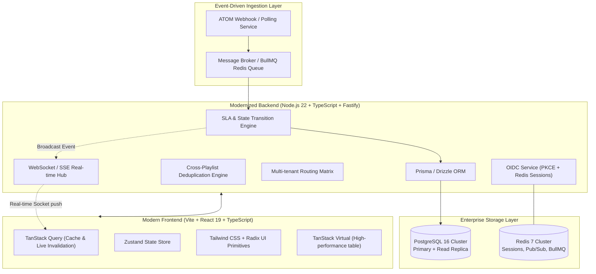
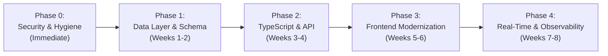

# Sentinel: Upgrade Analysis & Modernization Roadmap

> **Document Type**: Architectural Upgrade Blueprint & Technical Debt Audit  
> **Status**: Proposed / High-Priority  
> **Version**: 2.0 Architectural Vision  
> **Target Timeline**: Phased Modernization  

---

## 1. Executive Summary & Assessment

Sentinel currently serves as a functional MVP and operational prototype for Amagi TOC teams. However, it exhibits several architectural, operational, security, and scalability bottlenecks that must be resolved to elevate it into an enterprise-grade broadcast reliability platform.

### Summary Scorecard
| Dimension | Current State | Target State (Sentinel v2) | Priority |
| :--- | :--- | :--- | :--- |
| **Security & Secrets** | Hardcoded API keys in `.env`, no secret rotation | Secret Manager integration, KMS-backed secrets | P0 (Critical) |
| **Repository Hygiene** | `node_modules` committed in git, 4.6M lines in git history | Clean repo, git-filter-repo purge, clean CI/CD | P0 (Critical) |
| **Real-time Telemetry** | 30s client-side polling + 5m cron sync | WebSockets / Server-Sent Events (SSE) push | P1 (High) |
| **Data Layer & Scaling** | Embedded SQLite (single process, file lock) | PostgreSQL + Prisma/Drizzle with migration pipeline | P1 (High) |
| **Frontend Framework** | CRA (`react-scripts 5.0.1`), un-typed JS | Vite + React 19 + TypeScript + TanStack Query | P1 (High) |
| **Code Structure & Typing**| Raw JavaScript, prop drilling, implicit types | TypeScript strict mode, shared zod validation schemas | P1 (High) |
| **Automated Testing** | 0 unit tests, 0 integration tests, 0 e2e tests | Jest/Vitest + Playwright E2E testing suite | P2 (Medium) |
| **Observability** | Console logs + client SRE terminal | OpenTelemetry + Prometheus `/metrics` + Pino logger | P2 (Medium) |

---

## 2. Deep Dive: Architectural Gaps & Technical Debt

### 2.1 Security & Secret Vulnerabilities
1. **Plaintext Secrets in Source Control**: Freshdesk API keys and test configuration exist in `backend/.env`.
2. **Session Storage Inadequacies**: `connect-sqlite3` uses a second SQLite file (`backend/sessions.db`). In multi-container/Kubernetes pod replicas, user sessions cannot be shared across pods.
3. **Missing Reverse Proxy Routing for Auth**: `frontend/nginx.conf` fails to reverse-proxy `/auth/` endpoints, rendering containerized SSO non-functional.

### 2.2 Data Layer & Concurrency Limitations
1. **SQLite Concurrency Bottlenecks**: `better-sqlite3` is synchronous and locks the database during write transactions. If a 5-minute sync with hundreds of occurrences runs while operators are patching alert states or generating tickets, Express event loop latency spikes.
2. **Missing Schema Migration System**: Migrations are currently executed via opportunistic try-catch `ALTER TABLE` statements in `db.js`. There is no versioned migration tracking (e.g. Prisma Migrate, Flyway, or Umzug).
3. **Composite Key Inconsistencies**: `server.js` maintains both legacy numeric ID routes (`/api/issues/:id`) and composite key routes (`/api/issues/:atomIssueId/playlist/:playlistId`).

### 2.3 Real-time Capabilities & Polling Overhead
1. **Inefficient Double-Polling**:
   - Backend polls ATOM every 5 minutes.
   - Frontend polls backend `/api/issues/upcoming` every 30 seconds.
   - Operators may experience up to 5.5 minutes of delay before an urgent linear playout failure appears on their screens.
2. **Absence of Real-time Invalidation**: When an operator acknowledges an alert or creates a ticket, other operators' screens do not update until their next 30-second poll cycle.

### 2.4 Frontend Framework & Maintainability
1. **Create React App (CRA) Deprecation**: `react-scripts 5.0.1` is unmaintained, relies on deprecated Webpack 5 configurations, and suffers from slow build and dev server startup times.
2. **State Management & Prop Drilling**: Global state is loosely held in `App.js` and passed down through props. Telemetry utilizes an ad-hoc mutable object ref (`SREBus`, `_ctx`) rather than typed React context or a modern store (Zustand).
3. **Dead Code & Visual Discrepancy**: `AlertGroups.js` defines an outdated 4-state model (`not_ticketed`), whereas `IssueTable.js` uses the active 3-state model (`penalty`, `ack`, `ticketed`).

---

## 3. Sentinel v2 Target Architecture

---

## 4. Phased Upgrade Roadmap

### Phase 0: Immediate Security & Hygiene (P0 - Immediate)
- [ ] **Revoke & Rotate Freshdesk Credentials**: Invalidate exposed API token in Freshdesk admin console.
- [x] **Clean Git History**: Removed tracked `node_modules/` and SQLite databases from git tree using `git rm -r --cached */node_modules`.
- [x] **Fix Nginx Auth Proxy**: Added `location /auth/` block to `frontend/nginx.conf` so SSO functions in containerized environments.
- [x] **Enforce `.env.example`**: Standardized template variables in `backend/.env.example`.

### Phase 1: Data Layer & Persistence Modernization (P1)
- [ ] **PostgreSQL Migration**: Replace `better-sqlite3` with PostgreSQL (or provide seamless SQLite-for-local / Postgres-for-production switch via Prisma ORM).
- [x] **Declarative Schema Migrations**: Implemented version-controlled SQL migrations (`backend/migrations/001..003`) and transactional migration engine (`backend/migrator.js`).
- [ ] **Redis-backed Distributed Sessions**: Replace `connect-sqlite3` with `connect-redis` allowing horizontal scaling of backend pods.
- [ ] **Deprecate Legacy Numeric IDs**: Remove `/api/issues/:id` routes in favor of canonical composite keys `(atom_issue_id, playlist_id)`.

### Phase 2: TypeScript & Backend Architecture (P1)
- [ ] **TypeScript Conversion**: Port `backend/` to TypeScript with strict null checks.
- [ ] **Domain Validation via Zod**: Unify alert schemas, API query parameters, and Freshdesk payloads with Zod contracts.
- [x] **Comprehensive Test Suite**:
  - Unit tests for `alertTypes.js` (canonical enums, subjects, display labels).
  - Unit tests for `db.js` (schema migrations, composite key upserts, scoped occurrences, contact resolution, same-day persistence).
  - Integration tests for Express routes (`api.test.js`) testing health, metrics, alert types, upcoming issues, and state transitions. (19/19 tests passing).
- [ ] **Structured Logging**: Introduce Pino logger with JSON formatting, correlation IDs, and log level configuration.

### Phase 3: Frontend Modernization (P1)
- [ ] **Vite Migration**: Migrate from Create React App to Vite 6 for sub-second HMR and instant builds.
- [ ] **TypeScript in Frontend**: Convert JSX components to TSX.
- [ ] **TanStack Query (React Query)**: Replace manual `useEffect` polling and `fetch` calls with declarative query hooks. Automatic background refetching and cache invalidation.
- [ ] **Virtual Scrolling**: Implement `@tanstack/react-virtual` for `IssueTable` to seamlessly render thousands of historical and active alerts without DOM lag.
- [x] **Consolidate State Components**: Aligned `AlertGroups.js` to canonical 3-state model (`penalty`, `ack`, `ticketed`), eliminating broken legacy states, and implemented dual Table / Grouped view switcher on the Dashboard.

### Phase 4: Real-time Telemetry & Observability (P2)
- [ ] **WebSockets / Server-Sent Events (SSE)**: Implement SSE endpoint `/api/events` to push new incoming alerts directly to client screens within milliseconds.
- [ ] **Optimistic UI Updates**: Instantly reflect `penalty` -> `ack` transitions in UI while synchronizing in the background.
- [x] **Prometheus Metrics**: Expose `/metrics` endpoint with Prometheus counters (`sentinel_alerts_total`, `sentinel_alerts_by_state`, `sentinel_uptime_seconds`, `sentinel_sync_is_syncing`).
- [x] **Health Probes**: Implement standard Kubernetes probes:
  - `/healthz/live` (liveness)
  - `/healthz/ready` (readiness, verifying DB connectivity)
